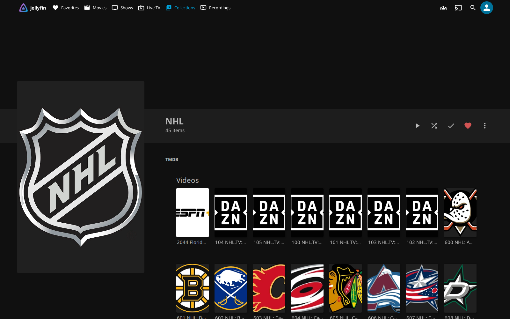
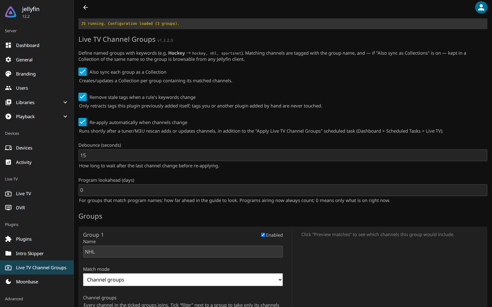
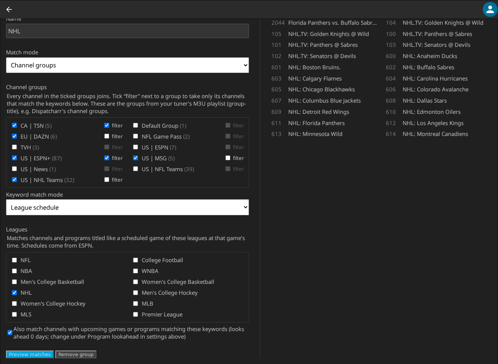
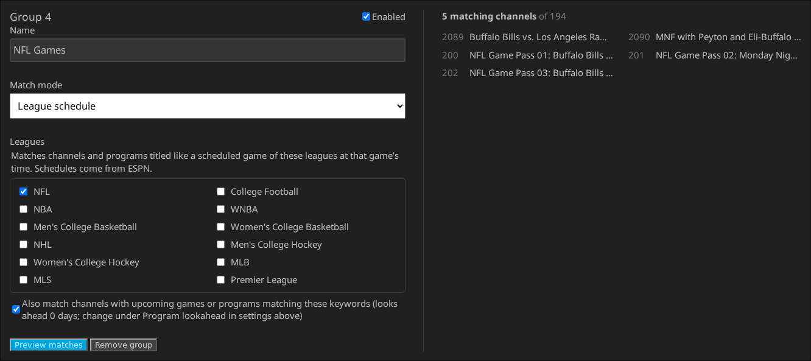
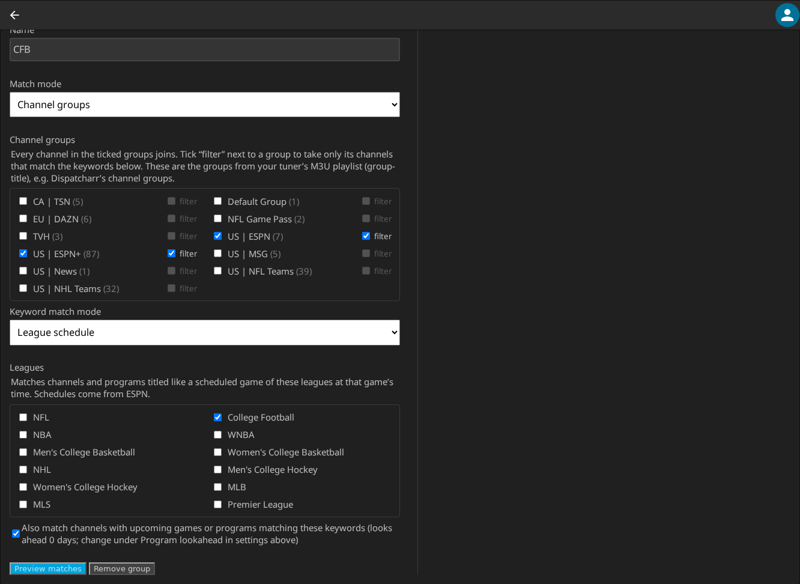

# Live TV Channel Groups

A Jellyfin plugin that groups Live TV channels by keyword. Define a group like
**Hockey** → `hockey, nhl, sportsnet` or **NFL** → `nfl, football, redzone`, and
every matching channel is tagged with the group name and, optionally, added to
a Collection of the same name that you can browse from any Jellyfin client.



## Features

- **Tags** — each matching channel gets a Tag with the group's name. Tags are
  standard Jellyfin metadata: they survive guide refreshes and can be queried
  with `/Items?IncludeItemTypes=TvChannel&Tags=Hockey`.
- **Collections** (on by default) — each group is kept in sync as a real
  Jellyfin Collection whose members are exactly the channels that currently
  match.
- **Flexible matching** — case-insensitive substring match by default, with
  whole-word and regular-expression modes available per group.
- **Program matching** (optional, per group) — also match on the names of
  upcoming guide programs, so a channel joins a group while it has a matching
  show or game scheduled.
- **Channel groups** — build a group straight from your tuner's own channel
  groups (an M3U playlist's `group-title`, such as Dispatcharr's channel
  groups), combining several and optionally narrowing them down by keyword.
- **League schedules** — instead of writing team-name patterns, pick leagues
  (NFL, college football, NHL, NBA, MLB, …) and match the games actually on
  their schedules, checked against the guide's start times.
- **Stays up to date automatically** — re-applies shortly after channels are
  added or updated (e.g. after a tuner or M3U rescan) or, for groups that match
  programs, after a guide refresh, and every 6 hours as a scheduled task.
- **Safe cleanup** — when a channel stops matching, only tags this plugin added
  are removed; tags you added yourself are never touched.
- **REST API** — preview matches or trigger an apply from scripts.

## Installation

1. In Jellyfin, go to **Dashboard → Plugins → Repositories** and add:
   - Name: `Live TV Channel Groups`
   - URL: `https://raw.githubusercontent.com/adamef93/jellyfin-live-tv-collections/main/manifest.json`
2. Open **Catalog → Live TV → Live TV Channel Groups** and click **Install**.
3. Restart Jellyfin.

Future releases appear as plugin updates like any official plugin.

**Requirements:** Jellyfin 10.11 or later (plugin ABI 10.11.0.0).

## Usage

1. Go to **Dashboard → Plugins → Live TV Channel Groups** (the plugin is also
   listed in the dashboard's sidebar, under **Plugins**).
2. Add a group, e.g. Name `Hockey`, Keywords `hockey, nhl, sportsnet`.
3. Click **Save**, then **Apply now** (or wait for the next automatic run).



Keywords are matched against the channel **name**. Tick **Also match program
names in the guide** on a group to also match the titles of programs airing now
or coming up within the lookahead window — e.g. an **NFL** group picks up CBS
during the week before a Sunday game, then drops it again once the game is no
longer in the guide window. Channel numbers are never matched.

Set a group's **Match mode** to **Channel groups** to build it from the groups
your tuner's M3U playlist puts channels in (`group-title`; with Dispatcharr,
these are its channel groups) instead of from keywords. Every channel in the
ticked groups joins. Tick **filter** next to a group to take only its channels
that also match keywords, with the usual match modes and program matching;
the other ticked groups are taken whole. For example, an NHL group can take the
NHL team and MSG groups whole and filter a mixed ESPN+ group down to NHL games.
Groups come from the tuner's channel list as of the last guide refresh.



Set **Match mode** (or a channel-group filter's **Keyword match mode**) to
**League schedule** to match games instead of keywords. Tick the leagues; a
channel or program then matches when its title names both teams of a game on
one of their schedules (`Georgia vs. Alabama`, `College Football : Georgia at
Alabama`, `NHL.TV: Flyers @ Bruins`) and the guide has it starting within 90
minutes of that game's scheduled start. The time check is what tells a football
game from the same two schools' volleyball match. Schedules come from ESPN's
public scoreboard and are cached for an hour; if they can't be fetched, the
plugin skips that apply pass rather than emptying the group.



League schedules also work as a channel-group filter. Here a college football
group takes only the ESPN and ESPN+ channels carrying a game on the college
football schedule:



### Settings

| Setting | Default | Description |
| --- | --- | --- |
| Also sync each group as a Collection | On | Keep a Collection in sync for each group, in addition to tags. |
| Remove stale tags when a rule's keywords change | On | Remove a group's tag from channels that no longer match it. |
| Re-apply automatically when channels change | On | Re-apply when channels are added or updated. |
| Debounce (seconds) | 15 | Wait this long after the last channel change before applying, so a large rescan triggers a single pass. |
| Program lookahead (days) | 7 | For groups that match program names, how far ahead in the guide to look. Programs airing now always count; `0` means only what is on right now. |

Each group can also be set to **Contains**, **Whole word**, or **Regular expression**
matching, made case-sensitive, or disabled without deleting it.

### Scheduled task

**Dashboard → Scheduled Tasks → Live TV → Apply Live TV Channel Groups** runs
every 6 hours by default. You can change the schedule or run it manually there.

### API

Both endpoints require an administrator. Create an API key under
**Dashboard → API Keys**.

| Endpoint | Description |
| --- | --- |
| `GET /LiveTvChannelGroups/Preview` | Lists the channels each group currently matches, without changing anything. |
| `POST /LiveTvChannelGroups/Apply` | Applies all groups now and returns a summary. |

```bash
curl -H 'Authorization: MediaBrowser Token="YOUR_API_KEY"' \
  http://localhost:8096/LiveTvChannelGroups/Preview

curl -X POST -H 'Authorization: MediaBrowser Token="YOUR_API_KEY"' \
  http://localhost:8096/LiveTvChannelGroups/Apply
```

## Troubleshooting

**Apply reports 0 channels scanned.** Check the Jellyfin log for entries from
"Live TV Channel Groups", and use the Preview endpoint to confirm your keywords
match the channel names as Jellyfin stores them.

**The config page's buttons don't work.** The page shows a status box at the
top. If it stays on "JavaScript has not run yet" or reports "ApiClient is not
defined", your client isn't running the page script. Try Jellyfin Web in a
desktop browser, or configure the plugin by hand:

1. Stop Jellyfin (it rewrites this file when settings are saved).
2. Create `<config-dir>/plugins/configurations/Jellyfin.Plugin.LiveTvChannelGroups.xml`:

   ```xml
   <?xml version="1.0" encoding="utf-8"?>
   <PluginConfiguration xmlns:xsi="http://www.w3.org/2001/XMLSchema-instance" xmlns:xsd="http://www.w3.org/2001/XMLSchema">
     <Groups>
       <ChannelGroupRule>
         <Id>hockey</Id>
         <Name>Hockey</Name>
         <Keywords>hockey, nhl, sportsnet</Keywords>
         <MatchMode>Contains</MatchMode>
         <CaseSensitive>false</CaseSensitive>
         <Enabled>true</Enabled>
         <CollectionId>00000000-0000-0000-0000-000000000000</CollectionId>
       </ChannelGroupRule>
     </Groups>
     <CreateCollections>true</CreateCollections>
     <RemoveStaleTags>true</RemoveStaleTags>
     <AutoApplyOnChannelChange>true</AutoApplyOnChannelChange>
     <DebounceSeconds>15</DebounceSeconds>
   </PluginConfiguration>
   ```

   `MatchMode` is one of `Contains`, `WholeWord` or `Regex`.
3. Start Jellyfin and run the scheduled task or call the Apply endpoint.

**The Dashboard says the plugin is incompatible.** This build targets plugin
ABI 10.11.0.0. If your server expects a different ABI, build from source with
`JellyfinVersion` in the csproj and `targetAbi` in `build.yaml` set to match
(see below).

## Building from source

Requires the .NET 9 SDK.

```bash
dotnet publish Jellyfin.Plugin.LiveTvChannelGroups -c Release -o out
```

To install the build manually, copy `out/Jellyfin.Plugin.LiveTvChannelGroups.dll`
and `meta.json` into a new folder under your Jellyfin plugins directory, then
restart Jellyfin:

```bash
mkdir -p "/path/to/config/plugins/Live TV Channel Groups_1.0.0.0"
cp out/Jellyfin.Plugin.LiveTvChannelGroups.dll meta.json \
   "/path/to/config/plugins/Live TV Channel Groups_1.0.0.0/"
```

In the official Docker image, the plugins directory is `/config/plugins`
inside the container.

## Releasing

Pushing a version tag runs `.github/workflows/release.yml`, which builds the
plugin, attaches the zip to a GitHub Release, and adds the version to
`manifest.json` on `main`. The annotated tag message becomes the changelog
shown in Jellyfin.

```bash
git tag -a v1.0.1 -m "Describe the changes"
git push origin v1.0.1
```

`v1.0.1` becomes plugin version `1.0.1.0`; `targetAbi` is read from
`build.yaml`.

## License

Public domain. See [LICENSE](LICENSE) ([The Unlicense](https://unlicense.org)).
